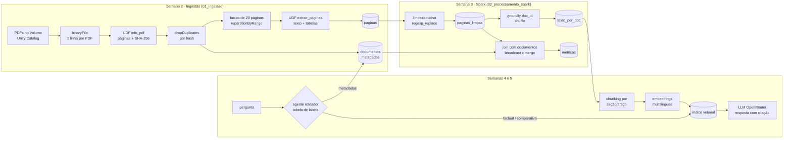

# Semana 1 · Arquitetura

## Decisões

| Decisão | Escolha | Por quê |
|---|---|---|
| Ambiente | Databricks Free Edition (serverless) | Spark gerenciado, sem instalar nada; *Query profile* mostra o shuffle na apresentação |
| Armazenamento | Volume do Unity Catalog para os PDFs; tabelas Delta em `workspace.rag_spark` | Cada etapa fica salva e pode ser consultada em SQL |
| Leitura de PDF | `binaryFile` + PyMuPDF dentro de UDF | A extração roda nos executores, não no driver; PyMuPDF também detecta tabelas (`find_tables`) |
| Particionamento | Faixas de 20 páginas, uma por partição (`repartitionByRange`) | A Portaria tem 169 páginas e os outros PDFs de 1 a 8; sem dividir, uma única tarefa seguraria o job inteiro |
| Limpeza | Funções nativas (`regexp_replace`) em vez de UDF | Rodam na JVM, sem serializar texto para o Python |
| Shuffle | `dropDuplicates`, `groupBy` e join `merge`, com `spark.sql.shuffle.partitions = 8` | Volume pequeno; 200 partições (padrão) gerariam tarefas vazias |
| Embeddings (semana 4) | Modelo multilíngue (ex.: `paraphrase-multilingual-MiniLM-L12-v2` ou `intfloat/multilingual-e5-small`) | O `all-MiniLM-L6-v2` da versão anterior foi treinado em inglês |
| LLM (semana 5) | Modelo gratuito via OpenRouter | Melhor português que o TinyLlama 1.1B e sem precisar de GPU |

## Tabelas geradas

| Tabela | Grão | Principais colunas |
|---|---|---|
| `inventario` | PDF | tabela intermediária com os bytes do PDF (`content`), hash e primeira página; existe porque o serverless não aceita `.cache()` |
| `documentos` | PDF | `doc_id`, `arquivo`, `tipo`, `numero`, `ano`, `orgao`, `processo_sei`, `exercicio_vaar`, `condicionalidades`, `assunto`, `n_paginas`, `bytes` |
| `paginas` | página | `doc_id`, `pagina`, `texto_bruto`, `n_chars`, `n_tabelas`, `tabelas` |
| `paginas_limpas` | página | `doc_id`, `pagina`, `texto`, `n_chars_limpo`, `n_palavras`, `n_tabelas` |
| `texto_por_doc` | PDF | `doc_id`, `texto` (com marcadores `[p. N]`), `n_palavras`, `n_tabelas` |
| `metricas_ingestao`, `metricas` | etapa | `etapa`, `segundos`, `detalhes` (JSON) |
